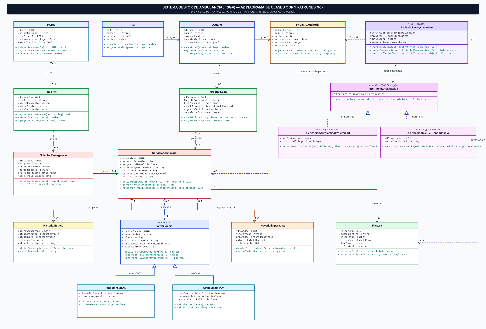

# A2 · Diagrama de Clases de Diseño Orientado a Objetos (OOP)
**Evidencia:** Guía 2 · Producto 1 (`G2-P1`) — Artefacto A2  
**Competencia:** 220501095 · **RAP:** 593103 (Criterio 2)  
**Aprendiz:** `MAET211` (Carpeta: `G2-P1-estrada`)  

---

## 1. Artefactos Visuales del Diagrama de Clases

- **Fuente editable (Draw.io XML):** [`02-diagrama-clases.drawio`](./02-diagrama-clases.drawio)
- **Imagen vectorial exportada (0 cruces):** [`02-diagrama-clases.svg`](./02-diagrama-clases.svg)

---

## 2. Decisiones de Diseño Orientado a Objetos (SRP, Herencia, Composición y Polimorfismo)

El diagrama evoluciona las 13 clases conceptuales del análisis (`G1-P2`) hacia **18 elementos de diseño** (1 clase abstracta, 1 interfaz y 16 clases concretas) tipados para **TypeScript 5**, aplicando estrictamente los principios solicitados en la rúbrica:

1. **Cohesión Alta y Responsabilidad Única (Criterio 2 — Regla 5):** Cada clase pertenece a una única área de responsabilidad:
   - *Entidades de dominio y seguridad:* `Rol`, `Usuario`, `Paciente`, `SolicitudEmergencia`, `Ambulancia` (`TAB`/`TAM`), `PersonalSalud`, `ServicioAsistencial`, `HistorialEstado`, `PQRS`, `NovedadOperativa`. Ninguna contiene código SQL, renderizado de interfaz UI, envío SMTP ni formato de reportes.
   - *Separación explícita de cobro y auditoría:* La lógica financiera y cálculo de mora reside exclusivamente en `Factura`; el registro inalterable reside en `RegistroAuditoria`.
   - *Orquestación y políticas de despacho:* Aisladas en los patrones GoF `FachadaEmergenciaSGA` (`Facade`) y la familia `IEstrategiaAsignacion` (`Strategy`).
2. **Herencia («es un»):** `Ambulancia` es clase abstracta con plantilla polimórfica `{abstract} calcularTarifaBase()` y `{abstract} validarDotacionMinima()`, especializada en `AmbulanciaTAB` (Transporte Básico) y `AmbulanciaTAM` (Transporte Medicalizado) conforme a la Resolución 3100.
3. **Composición («es parte de»):** `ServicioAsistencial "1" *-- "1..*" HistorialEstado` representa dependencia existencial fuerte: el historial de transiciones nace y se destruye dentro del ciclo de vida del servicio.
4. **Polimorfismo por Interfaz (2 implementaciones):** `IEstrategiaAsignacion` es implementada por `AsignacionAutomaticaProximidad` (`CU-03`) y `AsignacionManualContingencia` (`CU-04`), permitiendo intercambiar el algoritmo de selección en tiempo de ejecución sin modificar `FachadaEmergenciaSGA` ni `ServicioAsistencial`.

---

## 3. Catálogo de Clases, Responsabilidad y Trazabilidad

| # | Clase / Interfaz | Estereotipo / Tipo | Responsabilidad Única (Área) | Requisitos que Atiende |
| :-: |---|---|---|
| 1 | `Rol` | Concreta | Validar permisos RBAC por perfil del sistema (Seguridad) | `RF-005`, `RF-006`, `RF-053` |
| 2 | `Usuario` | Concreta | Autenticar credenciales y controlar bloqueo `RN-009` (Seguridad) | `RF-001`..`RF-004`, `RF-007`, `RF-038` |
| 3 | `Paciente` | Concreta | Custodiar datos demográficos y antecedentes clínicos (Dominio Clínico) | `RF-018`..`RF-020` |
| 4 | `SolicitudEmergencia` | Concreta | Capturar emergencia y evaluar nivel de Triage `RN-002` (Emergencias) | `RF-021` |
| 5 | `Ambulancia` | **Abstracta** | Definir contrato común de flota, vigencia REPS/SOAT y estado (Flota) | `RF-008`..`RF-012`, `RF-045`..`RF-054` |
| 6 | `AmbulanciaTAB` | Subclase (`extends`) | Validar dotación básica y tarifa de Transporte Básico `TAB` (Flota) | `RF-008`, `RF-013`, `RF-028` |
| 7 | `AmbulanciaTAM` | Subclase (`extends`) | Validar dotación avanzada/médica y tarifa `TAM` (Flota) | `RF-008`, `RF-013`, `RF-028` |
| 8 | `PersonalSalud` | Concreta | Controlar disponibilidad, certificaciones y turno continuo `RN-004` (Personal) | `RF-014`..`RF-017` |
| 9 | `ServicioAsistencial` | Concreta (Core) | Ejecutar máquina de 7 estados y validar cierre REPS `RN-005` (Emergencias) | `RF-022`..`RF-027`, `RF-029`, `RF-064`, `RF-065` |
| 10 | `HistorialEstado` | Concreta (Compuesta) | Registrar secuencia cronológica inmutable de transiciones de estado (Emergencias) | `RF-024`, `RF-026` |
| 11 | `Factura` | Concreta | Liquidar valor inmutable (`RN-014`), calcular mora (`RN-015`) y emitir notas (Cobro) | `RF-030`..`RF-035`, `RF-064` |
| 12 | `RegistroAuditoria` | Concreta | Estructurar pista inmutable de eventos por 5 años `RN-010` (Auditoría) | `RF-036`, `RF-037`, `RF-039`, `RF-049`, `RF-051`, `RF-052`, `RF-054`..`RF-058` |
| 13 | `PQRS` | Concreta | Gestionar radicado, plazo de asignación 24 h (`RN-011`) y respuesta (Atención) | `RF-040`..`RF-044` |
| 14 | `NovedadOperativa` | Concreta | Controlar incidentes/fallas, prioridad y resolución `RN-016` (Operación) | `RF-059`..`RF-063` |
| 15 | `IEstrategiaAsignacion` | **Interfaz (GoF Strategy)** | Contrato polimórfico para seleccionar unidad ante una solicitud | `RF-022`, `RF-023` |
| 16 | `AsignacionAutomaticaProximidad` | Implementa `IEstrategiaAsignacion` | Seleccionar unidad óptima `TAB`/`TAM` por distancia y REPS en $\le 2\text{ s}$ | `RF-022`, `RF-011`, `RNF-009` |
| 17 | `AsignacionManualContingencia` | Implementa `IEstrategiaAsignacion` | Asignar unidad seleccionada por coordinador validando justificación `RN-007` | `RF-023` |
| 18 | `FachadaEmergenciaSGA` | Concreta (**GoF Facade**) | Orquestar en una transacción unificada el despacho (`DA-01`) y el cierre paralelo (`DA-02`) | `RF-022`..`RF-025`, `RF-031`, `RF-055` |
