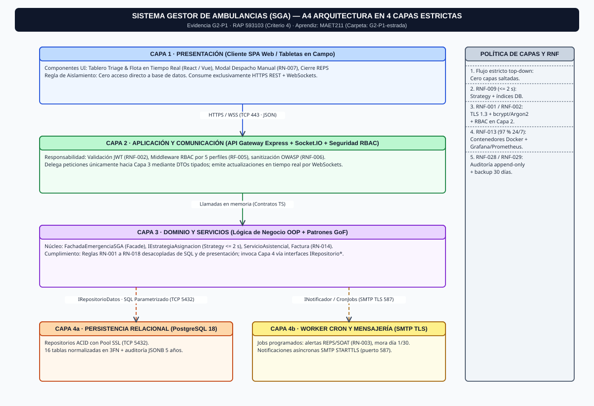

# A4 · Arquitectura del Software y Decisiones frente a RNF
**Evidencia:** Guía 2 · Producto 1 (`G2-P1`) — Artefacto A4  
**Competencia:** 220501095 · **RAP:** 593103 (Criterio 4)  
**Aprendiz:** `MAET211` (Carpeta: `G2-P1-estrada`)  

---

## 1. Estilo Arquitectónico y Diagrama de Capas

- **Estilo seleccionado:** **Arquitectura en Capas Estricta (4 Capas Lógicas sobre Monolito Modular Desacoplado)** — compatible con `RNF-025` (sostenibilidad modular sin saltos de capa).
- **Fuente editable (Draw.io XML):** [`04-arquitectura-sistema.drawio`](./04-arquitectura-sistema.drawio)
- **Imagen vectorial exportada (0 cruces):** [`04-arquitectura-sistema.svg`](./04-arquitectura-sistema.svg)

### Regla de Flujo Estricto (Cero Capas Saltadas)
1. **Capa 1 — Presentación (SPA Web / Móvil):** React/Vue en escritorio de coordinación y tabletas de tripulación. Solo consume la Capa 2 mediante `HTTPS/WSS`; **tiene prohibido** conectarse a la base de datos o ejecutar lógica de negocio financiera/clínica.
2. **Capa 2 — Aplicación y Comunicación (API Gateway REST + Socket.IO + Middleware RBAC):** Valida tokens `JWT`, aplica autorización `RBAC` (`RF-005`), sanitiza entradas OWASP (`RNF-006`) y delega exclusivamente en la Capa 3.
3. **Capa 3 — Dominio y Servicios (Patrones `Facade` + `Strategy` + Entidades OOP):** Implementa todas las reglas `RN-001`..`RN-018` sin conocer detalles SQL ni HTTP; consume datos exclusivamente a través de interfaces hacia la Capa 4.
4. **Capa 4 — Persistencia e Integraciones Externas (Repositorios + PostgreSQL 18 + SMTP):** Ejecuta consultas SQL parametrizadas ACID sobre PostgreSQL 18 y despacha alertas SMTP (`TLS 587`).

---

## 2. Estilos de Comunicación entre Capas y Componentes

| Frontera | Estilo / Protocolo de Comunicación | Formato e Invariante |
|---|---|---|
| Capa 1 (Presentación) $\leftrightarrow$ Capa 2 (API) | **Síncrono REST (`HTTPS TLS 1.3`, puerto `443`) + Asíncrono bidireccional (`WebSockets / WSS`, puerto `443`)** | Cargas `JSON` tipadas bajo esquema; eventos *push* de flota (`RF-009`, `RF-028`) por Socket.IO sin recargar pantalla. |
| Capa 2 (Controladores) $\rightarrow$ Capa 3 (Dominio) | **Llamadas síncronas tipadas en memoria (TypeScript / Inyección de Dependencias)** | DTOs validados; la Capa 2 nunca salta directamente hacia la Capa 4 de datos. |
| Capa 3 (Dominio) $\rightarrow$ Capa 4 (Repositorios) | **Inversión de Dependencias (`IRepositorio*`) con promesas asíncronas `async/await`** | Transacciones explícitas (`BEGIN ... COMMIT / ROLLBACK`) en operaciones críticas de despacho (`CU-03`) y cierre (`CU-05`). |
| Capa 4 (Repositorios) $\rightarrow$ Motor de Datos | **Conexión TCP privada cifrada (`PostgreSQL SSL`, puerto `5432`)** | Pool de conexiones parametrizadas (prevención total de SQL Injection `RNF-006`). |
| Capa 3/4 $\rightarrow$ Alertas Externas | **Mensajería asíncrona no bloqueante (`SMTP STARTTLS`, puerto `587` vía Job Cron)** | Notificaciones de recuperación de clave y alertas `SOAT`/`REPS`/mora fuera del hilo crítico de respuesta de emergencias. |

---

## 3. Tabla de Decisiones Arquitectónicas frente a RNF y Alternativas Descartadas

| Requisito / Estilo | Decisión de Arquitectura Adoptada | Alternativa Descartada | Razón Técnica del Descarte |
|---|---|---|---|
| **Estilo global (`RNF-025`)** | **Arquitectura en 4 Capas Estrictas (Monolito Modular)** sin saltos de capa, con interfaces entre Dominio y Persistencia. | **Microservicios distribuidos desde el Día 1** (6+ servicios con bus Kafka). | Un equipo de 4 aprendices incurriría en alta sobrecarga operativa, latencia de red entre despacho/facturación y complejidad de transacciones distribuidas (2PC/Sagas) sin necesidad inicial. |
| **`RNF-001` / `RNF-002` / `RNF-003` (Seguridad y RBAC)** | Terminación `TLS 1.3` en Nginx; `JWT` firmado + middleware `RBAC` en Capa 2; `bcrypt`/`Argon2` con sal única; prohibición de acceso directo UI $\rightarrow$ DB. | **Validar permisos RBAC únicamente ocultando botones en la UI** o almacenar contraseñas cifradas con AES reversible. | Ocultar controles en frontend es evadible consumiendo directamente la API; el cifrado reversible expone claves ante robo de la BD, violando `RNF-001`. |
| **`RNF-008` / `RNF-009` (Despacho $\le 2\text{ s}$)** | Algoritmo de filtrado `Strategy` ejecutado en memoria sobre índices compuestos PostgreSQL `(estado_operativo, tipo)` + canales `WebSockets` para actualización inmediata sin *polling*. | **Polling HTTP periódico desde el cliente cada 2 s** y consulta secuencial sin índices ni filtrado REPS en DB. | El polling saturaría las conexiones con $\ge 20$ usuarios (`RNF-010`), desperdiciando ancho de banda y retrasando emergencias vitales Rojo/Naranja. |
| **`RNF-013` / `RNF-015` (Disponibilidad 97 % 24/7)** | Contenedores Docker con política `restart: always`, monitoreo continuo con **Grafana/Prometheus**, aislamiento de trabajos Cron (`REPS`/reportes) y pool transaccional resiliente. | **Despliegue manual de scripts sin gestor de procesos ni monitoreo**. | Caídas no detectadas o reinicios sin recuperación automática violarían la operación crítica prehospitalaria 24/7. |
| **`RNF-028` / `RNF-029` (Auditoría y Respaldo 5 años)** | Tabla `auditorias` `append-only` con instantáneas `JSONB` (sin `UPDATE`/`DELETE` para rol aplicativo) + respaldo automático diario en almacenamiento externo (`30` copias, `RTO <= 4 h`). | **Logs en archivos planos de texto locales** del servidor VPS únicamente. | Los archivos planos locales son vulnerables a manipulación, difíciles de consultar por `OLD/NEW` (`RF-057`) y se pierden si falla el disco principal. |
