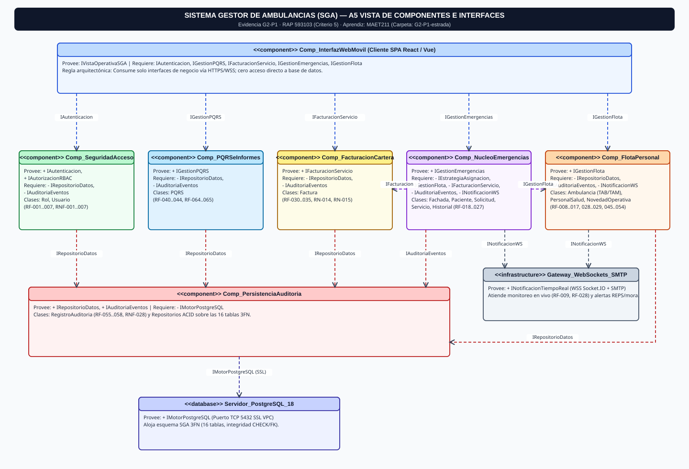

# A5 · Vista de Componentes e Interfaces del Sistema
**Evidencia:** Guía 2 · Producto 1 (`G2-P1`) — Artefacto A5  
**Competencia:** 220501095 · **RAP:** 593103 (Criterio 5)  
**Aprendiz:** `MAET211` (Carpeta: `G2-P1-estrada`)  

---

## 1. Artefactos Visuales de Componentes

- **Fuente editable (Draw.io XML):** [`05-vista-componentes.drawio`](./05-vista-componentes.drawio)
- **Imagen vectorial exportada (0 cruces):** [`05-vista-componentes.svg`](./05-vista-componentes.svg)

---

## 2. Catálogo de Componentes, Interfaces, Clases y Requisitos (Criterio 5 — Nivel 100)

El sistema se descompone en **7 componentes cohesionados** (superando el mínimo de 5), respetando estrictamente la separación de capas: el componente cliente (`Comp_InterfazWebMovil`) consume únicamente interfaces de negocio expuestas por la API y **nunca accede directamente a la base de datos ni al componente de persistencia**.

| # | Componente | Interfaz que Provee | Interfaces que Requiere | Clases de Diseño que Agrupa (`A2`) | Requisitos que Atiende (`SRS`) |
| :-: |---|---|---|---|---|
| 1 | **`Comp_InterfazWebMovil`** | `IVistaOperativaSGA` | `IAutenticacion`, `IGestionEmergencias`, `IGestionFlota`, `IFacturacionServicio`, `IGestionPQRS` | *(SPA React/Vue en cliente web/tableta)* | `RF-009`, `RF-028`, `RF-029`, `RF-042`, `RNF-016`..`RNF-020` |
| 2 | **`Comp_SeguridadAcceso`** | `IAutenticacion`, `IAutorizacionRBAC` | `IRepositorioDatos`, `IAuditoriaEventos` | `Rol`, `Usuario` | `RF-001`..`RF-007`, `RF-038`, `RF-053`, `RNF-001`..`RNF-007` |
| 3 | **`Comp_NucleoEmergencias`** | `IGestionEmergencias` | `IEstrategiaAsignacion`, `IGestionFlota`, `IFacturacionServicio`, `IAuditoriaEventos`, `INotificacionTiempoReal` | `FachadaEmergenciaSGA`, `Paciente`, `SolicitudEmergencia`, `ServicioAsistencial`, `HistorialEstado`, `IEstrategiaAsignacion`, `AsignacionAutomaticaProximidad`, `AsignacionManualContingencia` | `RF-018`..`RF-027`, `RF-059`, `RF-060`, `RF-062`, `RNF-009` |
| 4 | **`Comp_FlotaPersonal`** | `IGestionFlota` | `IRepositorioDatos`, `IAuditoriaEventos`, `INotificacionTiempoReal` | `Ambulancia`, `AmbulanciaTAB`, `AmbulanciaTAM`, `PersonalSalud`, `NovedadOperativa` | `RF-008`..`RF-017`, `RF-028`..`RF-029`, `RF-036`..`RF-039`, `RF-045`..`RF-054`, `RF-061`, `RF-063`, `RNF-008` |
| 5 | **`Comp_FacturacionCartera`** | `IFacturacionServicio` | `IRepositorioDatos`, `IAuditoriaEventos` | `Factura` | `RF-030`..`RF-035`, `RN-014`, `RN-015` |
| 6 | **`Comp_PQRSeInformes`** | `IGestionPQRS` | `IRepositorioDatos`, `IAuditoriaEventos` | `PQRS` | `RF-040`..`RF-044`, `RF-064`, `RF-065`, `RN-011`, `RN-018` |
| 7 | **`Comp_PersistenciaAuditoria`** | `IRepositorioDatos`, `IAuditoriaEventos` | `IMotorPostgreSQL` *(Motor DB externo)* | `RegistroAuditoria` | `RF-055`..`RF-058`, `RNF-021`, `RNF-028`, `RNF-029`, `RN-010` |

### Componentes de Infraestructura Asociados en el Diagrama
- **`Gateway_WebSockets_SMTP`** (Provee `INotificacionTiempoReal`): canal bidireccional Socket.IO para actualización en tiempo real (`CU-07`) y notificaciones SMTP de vencimientos/mora (`RF-011`, `RF-033`, `RF-041`, `RF-047`).
- **`Servidor_PostgreSQL_18`** (Provee `IMotorPostgreSQL`): motor relacional consumido exclusivamente por `Comp_PersistenciaAuditoria`.
