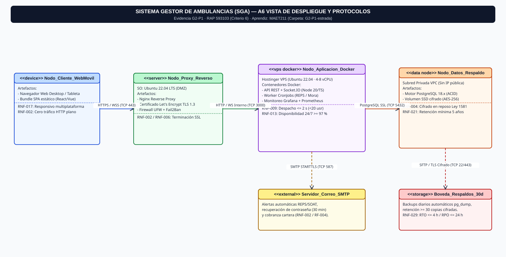

# A6 · Vista de Despliegue y Topología de Red
**Evidencia:** Guía 2 · Producto 1 (`G2-P1`) — Artefacto A6  
**Competencia:** 220501095 · **RAP:** 593103 (Criterio 6)  
**Aprendiz:** `MAET211` (Carpeta: `G2-P1-estrada`)  

---

## 1. Artefactos Visuales de Despliegue

- **Fuente editable (Draw.io XML):** [`06-vista-despliegue.drawio`](./06-vista-despliegue.drawio)
- **Imagen vectorial exportada (0 cruces):** [`06-vista-despliegue.svg`](./06-vista-despliegue.svg)

---

## 2. Especificación de Nodos, Artefactos, Protocolos y Decisiones RNF (Criterio 6 — Nivel 100)

El despliegue se diseña sobre **4 nodos físicos/lógicos** alineados con las Secciones 3.2 y 3.3 del SRS del SGA (superando el mínimo de 3 nodos):

| # | Nodo | Artefactos que Aloja | Conexiones (Protocolo y Puerto) | Decisión de Despliegue frente a RNF |
| :-: |---|---|---|---|
| 1 | **`Nodo_Cliente_WebMovil`** *(Estaciones de despacho / Tabletas en ambulancia)* | Navegador Web (`Chrome 100+` / `Edge` / `Safari`), bundle estático SPA (`React`/`Vue`) | **HTTPS + WSS (`TCP 443`)** hacia `Nodo_Proxy_Reverso` | **`RNF-002` y `RNF-017`:** Todo tráfico clínico y credenciales viaja cifrado con TLS 1.3; opera sin instalación local en escritorio y tabletas en ruta. |
| 2 | **`Nodo_Proxy_Reverso`** *(Zona DMZ / Edge Ubuntu 22.04)* | `Nginx` Reverse Proxy, Certificado `Let's Encrypt TLS 1.3`, `Firewall` + `Fail2Ban` | • Recibe **`HTTPS / WSS (TCP 443)`** externo. • Reenvía **`HTTP / WS interno (TCP 3000)`** en red Docker privada hacia `Nodo_Aplicacion_Docker`. | **`RNF-002` y `RNF-006`:** Redirección forzada HTTP (80) $\rightarrow$ HTTPS (443), limitación de tasa (*rate limiting*) y bloqueo automático de IP ante ataques de fuerza bruta. |
| 3 | **`Nodo_Aplicacion_Docker`** *(Servidor Hostinger VPS 4–8 vCPU / 8–16 GB RAM / Ubuntu 22.04 + Docker)* | Contenedor API REST & `Socket.IO` (`Node.js 20 + TypeScript`), Contenedor Worker `CronJobs` (`REPS` / `Mora` / reportes), Contenedor `Prometheus / Grafana` | • **`PostgreSQL SSL (TCP 5432)`** hacia `Nodo_Datos_Respaldo` por subred VPC aislada. • **`SMTP STARTTLS (TCP 587)`** saliente hacia Servidor de Correo Institucional. | **`RNF-009`, `RNF-010` y `RNF-013`:** Orquestación Docker con reinicio automático (`24/7`, uptime $\ge 97\%$) y ejecución en baja latencia local para despachos en $\le 2\text{ s}$ con $\ge 20$ usuarios concurrentes. |
| 4 | **`Nodo_Datos_Respaldo`** *(Subred Privada Sin Acceso Directo a Internet)* | Motor **PostgreSQL 18.x** sobre volumen SSD cifrado + Almacenamiento externo de copias (`pg_dump` / Snapshots diarios) | • Solo acepta **`TCP 5432 (SSL)`** desde la IP privada de `Nodo_Aplicacion_Docker`. • Envío diario cifrado **`TLS / SFTP (TCP 443 / 22)`** hacia bóveda externa de respaldos. | **`RNF-004`, `RNF-021` y `RNF-029`:** Base de datos invisible desde internet; cifrado en reposo bajo Ley 1581/2012; retención de $\ge 30$ respaldos diarios automáticos (`RTO <= 4 h`, `RPO <= 24 h`). |
