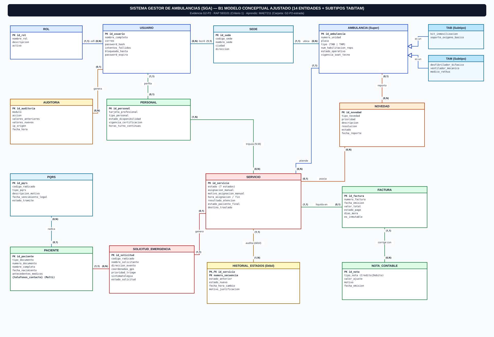

# B1 · Modelo Conceptual de Datos Ajustado para PostgreSQL
**Evidencia:** Guía 2 · Producto 2 (`G2-P2`) — Artefacto B1  
**Competencia:** 220501095 · **RAP:** 593101 (Criterio 1)  
**Aprendiz:** `MAET211` (Carpeta: `G2-P2-estrada`)  
**Insumo Base:** [`03-modelo-dominio.svg`](../../../../01-analysis/03-conceptual-model/04-evidence-learning/G1-P2-estrada/03-modelo-dominio.svg) y [`04-modelo-entidad-relacion.svg`](../../../../01-analysis/03-conceptual-model/04-evidence-learning/G1-P2-estrada/04-modelo-entidad-relacion.svg)  

---

## 1. Artefactos Visuales del Modelo Conceptual

- **Fuente editable (Draw.io XML):** [`01-modelo-conceptual-datos.drawio`](./01-modelo-conceptual-datos.drawio)
- **Imagen vectorial exportada (0 cruces):** [`01-modelo-conceptual-datos.svg`](./01-modelo-conceptual-datos.svg)

---

## 2. Reutilización y Ajustes Realizados respecto a Guía 1 (`Rubricas_G2.md` Sec. 1.1)

Partiendo de los modelos de Guía 1 (`13` entidades troncales), se aplicaron **5 ajustes sustantivos de ingeniería de datos** para preparar el paso hacia un esquema relacional PostgreSQL en 3FN:
1. **Incorporación de entidad `SEDE` (`RF-010`, SRS Sec. 6.2.3):** Separa código, nombre, ciudad y dirección de base operativa respecto de `USUARIO` y `AMBULANCIA`, eliminando dependencias transitivas (`3FN`).
2. **Declaración de atributo multivaluado en `PACIENTE` (`RF-018`):** Se modela `{telefonos_contacto}` como atributo multivaluado (teléfono personal, familiar o acompañante), el cual dará lugar en `B2` a la tabla `paciente_telefonos`.
3. **Generalización `AMBULANCIA` $\rightarrow$ `TAB` / `TAM` (`RN-002`):** Se preserva en el modelo conceptual la jerarquía especializada entre Transporte Asistencial Básico y Medicalizado para sustentar la regla de transformación aplicada en `B2`.
4. **Adición de `NOTA_CONTABLE` (`RF-031`, `RN-014`):** Refuerza la inmutabilidad estricta de `FACTURA`: toda corrección financiera se modela como entidad independiente (`1` factura `0..N` notas).
5. **Estandarización de identificadores conceptuales:** Todas las entidades usan notación consistente Crow's Foot / cardinalidades `(min, max)` con verbo de relación y traza directa al SRS (`RF-001`..`RF-065`).

---

## 3. Justificación del Tipo de Base de Datos (Relacional — PostgreSQL 18)

- **Relaciones estructuradas fijas e invariantes legales:** El núcleo `SEDE` $\rightarrow$ `AMBULANCIA` $\rightarrow$ `SERVICIO` $\leftarrow$ `SOLICITUD_EMERGENCIA` $\leftarrow$ `PACIENTE` requiere integridad referencial estricta verificada por el motor.
- **Consistencia ACID en despacho concurrente (`RN-001`, `RNF-009`):** Evita condiciones de carrera cuando dos coordinadores consultan o asignan una ambulancia en el mismo instante ($\le 2\text{ s}$).
- **Auditoría e inmutabilidad (`RN-010`, `RN-014`):** Exige restricciones declarativas (`CHECK`, `UNIQUE`, `FK ON DELETE RESTRICT`) y soporte nativo `JSONB`/`UUID`/`INET`.

---

## 4. Catálogo de Entidades Conceptuales, Cardinalidades y Trazabilidad (`14` Entidades + `2` Subtipos)

| # | Entidad Conceptual | Identificador Principal | Atributos Destacados (Incl. Multivaluado) | Relaciones y Cardinalidad `(mín, máx)` | Requisitos |
| :-: |---|---|---|---|---|
| 1 | `SEDE` | `id_sede` | `codigo_sede`, `nombre_sede`, `ciudad`, `direccion` | `SEDE (1,1) -- ubica -- (0,N) AMBULANCIA`; `(1,1) -- adscribe -- (0,N) USUARIO` | `RF-010`, `RF-036`..`RF-039` |
| 2 | `ROL` | `id_rol` | `nombre_rol`, `descripcion`, `activo` | `ROL (1,1) -- clasifica -- (0,N) USUARIO` | `RF-005`, `RF-006`, `RF-053` |
| 3 | `USUARIO` | `id_usuario` | `nombre_completo`, `correo`, `password_hash`, `intentos_fallidos` | `USUARIO (1,1) -- perfila -- (0,1) PERSONAL`; `(1,1) -- registra -- (0,N) AUDITORIA` | `RF-001`..`RF-007` |
| 4 | `PERSONAL` | `id_personal` | `tarjeta_profesional`, `tipo_personal`, `vigencia_certificacion` | `PERSONAL (1,N) -- tripula (N:M) -- (0,N) SERVICIO` | `RF-014`..`RF-017` |
| 5 | `PACIENTE` | `id_paciente` | `tipo_documento`, `numero_documento`, `nombre_completo`, **`{telefonos_contacto}`** | `PACIENTE (1,1) -- origina -- (0,N) SOLICITUD_EMERGENCIA`; `(0,1) -- radica -- (0,N) PQRS` | `RF-018`..`RF-020` |
| 6 | `AMBULANCIA` *(Super)* | `id_ambulancia` | `numero_unidad`, `placa`, `tipo`, `num_habilitacion_reps`, `vigencia_soat_tecno` | Especializa en `TAB` y `TAM`; `AMBULANCIA (1,1) -- atiende -- (0,N) SERVICIO` | `RF-008`..`RF-013`, `RF-045`..`RF-054` |
| 7–8 | `TAB` / `TAM` *(Subtipos)* | `(heredados)` | `TAB` (dotación básica) / `TAM` (soporte avanzado médico) | Herencia disjunta y total de `AMBULANCIA` (`RN-002`) | `RF-008`, `RF-013`, `RF-028` |
| 9 | `SOLICITUD_EMERGENCIA` | `id_solicitud` | `codigo_radicado`, `prioridad_triage`, `direccion_evento`, `sintomatologia` | `SOLICITUD_EMERGENCIA (1,1) -- despacha -- (0,1) SERVICIO` | `RF-021` |
| 10 | `SERVICIO` | `id_servicio` | `estado`, `asignacion_manual`, `motivo_asignacion_manual`, `resultado_atencion` | Núcleo conectado con `AMBULANCIA`, `PERSONAL` (N:M), `FACTURA` `(1,1)-(0,1)` y `NOVEDAD` | `RF-022`..`RF-029` |
| 11 | `HISTORIAL_ESTADOS_SERVICIO` *(Débil)* | `(id_servicio, numero_secuencia)` | `estado_anterior`, `estado_nuevo`, `fecha_hora_cambio`, `motivo_justificacion` | `SERVICIO (1,1) -- audita transición (dependencia existencial) -- (1,N) HISTORIAL` | `RF-024`, `RF-026` |
| 12 | `FACTURA` | `id_factura` | `numero_factura`, `valor_total`, `estado_pago`, `dias_mora`, `es_inmutable` | `SERVICIO (1,1) -- liquida en -- (0,1) FACTURA`; `FACTURA (1,1) -- corrige con -- (0,N) NOTA_CONTABLE` | `RF-030`..`RF-035` |
| 13 | `NOTA_CONTABLE` | `id_nota` | `tipo_nota`, `valor_ajuste`, `motivo`, `fecha_emision` | Asociada obligatoriamente a `FACTURA` y usuario autorizador (`RN-014`) | `RF-031` |
| 14 | `PQRS` | `id_pqrs` | `codigo_radicado`, `tipo_pqrs`, `fecha_vencimiento_legal`, `estado_tramite` | Vinculada opcionalmente a `PACIENTE (0,1)` y responsable `USUARIO (0,1)` | `RF-040`..`RF-044` |
| 15 | `NOVEDAD` | `id_novedad` | `tipo_novedad`, `prioridad`, `descripcion`, `resolucion`, `estado` | `SERVICIO (0,1) -- reporta -- (0,N) NOVEDAD`; `AMBULANCIA (0,1) -- (0,N) NOVEDAD` | `RF-059`..`RF-063` |
| 16 | `AUDITORIA` | `id_auditoria` | `modulo`, `accion`, `valores_anteriores`, `valores_nuevos`, `ip_origen` | `USUARIO (0,1) -- genera -- (0,N) AUDITORIA` (incluye eventos automáticos del sistema) | `RF-055`..`RF-058` |
