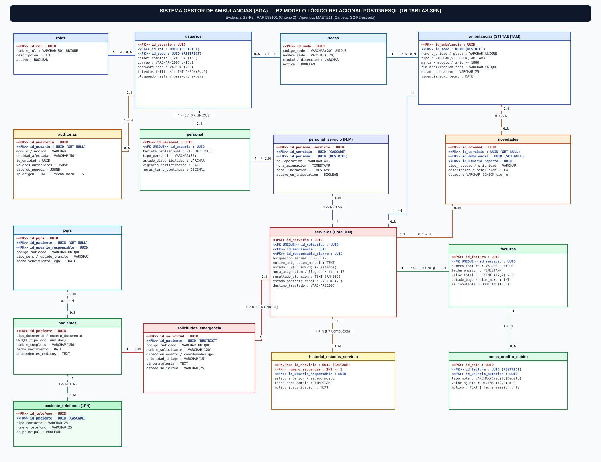

# B2 · Modelo Lógico Relacional y Reglas de Transformación
**Evidencia:** Guía 2 · Producto 2 (`G2-P2`) — Artefacto B2  
**Competencia:** 220501095 · **RAP:** 593101 (Criterio 2)  
**Aprendiz:** `MAET211` (Carpeta: `G2-P2-estrada`)  

---

## 1. Artefactos Visuales del Modelo Lógico Relacional (PostgreSQL 18 — 16 Tablas en 3FN)

- **Fuente editable (Draw.io XML):** [`02-modelo-logico-relacional.drawio`](./02-modelo-logico-relacional.drawio)
- **Imagen vectorial exportada (0 cruces):** [`02-modelo-logico-relacional.svg`](./02-modelo-logico-relacional.svg)

---

## 2. Cuadro Completo de Reglas de Transformación Aplicadas (Conceptual B1 $\rightarrow$ Lógico B2)

| Regla de Transformación Estándar | Caso Concreto en el Modelo SGA (`B1`) | Resultado Exacto en el Modelo Lógico Relacional (`B2` / `B5`) |
|---|---|---|
| **Entidad Fuerte $\rightarrow$ Tabla Relacional** | Entidades independientes (`SEDE`, `ROL`, `USUARIO`, `PERSONAL`, `PACIENTE`, `AMBULANCIA`, `SOLICITUD_EMERGENCIA`, `SERVICIO`, `FACTURA`, `NOTA_CONTABLE`, `PQRS`, `NOVEDAD`, `AUDITORIA`). | Tablas en plural `snake_case` con llave primaria `UUID` (`id_<singular>`), tipos estrictos PostgreSQL y restricciones `NOT NULL`/`UNIQUE`. |
| **Relación `1:N` $\rightarrow$ Clave Foránea en el lado «muchos»** | • `SEDE (1)` $\rightarrow$ `AMBULANCIA (0..N)` y `USUARIO (0..N)` • `ROL (1)` $\rightarrow$ `USUARIO (0..N)` • `PACIENTE (1)` $\rightarrow$ `SOLICITUD_EMERGENCIA (0..N)` • `AMBULANCIA (1)` $\rightarrow$ `SERVICIO (0..N)` • `FACTURA (1)` $\rightarrow$ `NOTA_CONTABLE (0..N)` | Columna FK migrada al lado muchos con acción referencial explícita (`ON DELETE RESTRICT ON UPDATE CASCADE` para integridad histórica REPS). |
| **Relación `1:1` / `1:0..1` $\rightarrow$ FK `UNIQUE`** | • `USUARIO (1)` $\leftrightarrow$ `PERSONAL (0..1)` • `SOLICITUD_EMERGENCIA (1)` $\leftrightarrow$ `SERVICIO (0..1)` • `SERVICIO (1)` $\leftrightarrow$ `FACTURA (0..1)` | Se coloca FK con restricción **`UNIQUE`** en la tabla dependiente (`personal.id_usuario`, `servicios.id_solicitud`, `facturas.id_servicio`), impidiendo duplicación estructural. |
| **Relación `N:M` $\rightarrow$ Tabla Intermedia / Asociativa** | Un `SERVICIO` requiere múltiples tripulantes (`PERSONAL`) y cada tripulante atiende múltiples `SERVICIO`s a lo largo del tiempo (`RF-017`). | Creación de tabla intermedia **`personal_servicio`** con PK propia `id_personal_servicio`, FKs a `servicios` y `personal` (`UNIQUE (id_servicio, id_personal)`) y atributos propios (`rol_operativo`, `hora_asignacion`, `hora_liberacion`, `activo_en_tripulacion`). |
| **Entidad Débil $\rightarrow$ PK Compuesta Identificadora** | Cada transición de estado de un servicio depende existencialmente del `SERVICIO` padre (`RF-024`). | Tabla **`historial_estados_servicio`** con clave primaria compuesta **`PRIMARY KEY (id_servicio, numero_secuencia)`**, propagando `id_servicio` como `PK, FK` (`ON DELETE CASCADE`). |
| **Atributo Multivaluado $\rightarrow$ Tabla Aparte (1FN)** | `PACIENTE` posee el atributo multivaluado `{telefonos_contacto}` (teléfono personal, de familiar y acompañante por emergencia `RF-018`). | Creación de tabla hija **`paciente_telefonos`** (`id_telefono PK`, `id_paciente FK ON DELETE CASCADE`, `tipo_contacto`, `numero_telefono`, `es_principal`), garantizando atomicidad 1FN. |
| **Generalización / Especialización (`TAB` / `TAM`)** | `AMBULANCIA` se especializa en subtipos disjuntos y totales `TAB` y `TAM` (`RN-002`, `RF-008`, `RF-013`). | **Estrategia adoptada: Tabla única con discriminador** (`ambulancias.tipo VARCHAR(5) CHECK (tipo IN ('TAB','TAM'))`). *Justificación:* `TAB` y `TAM` comparten el 100 % de sus columnas clave de inventario y despacho, y evitar un `JOIN` extra garantiza consultas de asignación automática en $\le 2\text{ s}$ (`RNF-009`). |

---

## 3. Resumen de las 16 Tablas del Modelo Lógico Final

1. `sedes` (`PK id_sede`)
2. `roles` (`PK id_rol`)
3. `usuarios` (`PK id_usuario`, `FK id_rol`, `FK id_sede`)
4. `personal` (`PK id_personal`, `FK UNIQUE id_usuario`)
5. `pacientes` (`PK id_paciente`)
6. `paciente_telefonos` (`PK id_telefono`, `FK id_paciente`)
7. `ambulancias` (`PK id_ambulancia`, `FK id_sede`)
8. `solicitudes_emergencia` (`PK id_solicitud`, `FK id_paciente`)
9. `servicios` (`PK id_servicio`, `FK UNIQUE id_solicitud`, `FK id_ambulancia`, `FK id_responsable_cierre`)
10. `personal_servicio` (`PK id_personal_servicio`, `FK id_servicio`, `FK id_personal`)
11. `historial_estados_servicio` (`PK (id_servicio, numero_secuencia)`, `FK id_usuario_responsable`)
12. `facturas` (`PK id_factura`, `FK UNIQUE id_servicio`)
13. `notas_credito_debito` (`PK id_nota`, `FK id_factura`, `FK id_usuario_autoriza`)
14. `pqrs` (`PK id_pqrs`, `FK id_paciente`, `FK id_usuario_responsable`)
15. `novedades` (`PK id_novedad`, `FK id_servicio`, `FK id_ambulancia`, `FK id_usuario_reporta`)
16. `auditorias` (`PK id_auditoria`, `FK id_usuario`)
